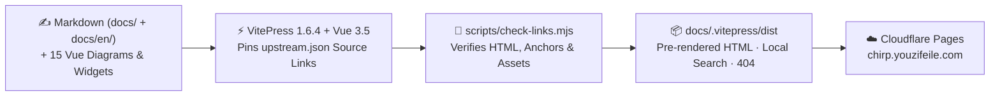

<div align="center">

<a href="https://chirp.youzifeile.com/en/">
  
</a>

# Chirp-Doc-Page

**Official Documentation Portal for Chirp · Bilingual (ZH/EN) · Interactive E2EE Diagrams & Hosting Guides**

<p>
  <a href="README.md"><strong>简体中文</strong></a>
  &nbsp;|&nbsp;
  <strong>English</strong>
</p>

<p>
  <a href="https://chirp.youzifeile.com/en/"></a>
  <a href="https://github.com/YouZiFeiLe/Chirp-Doc-Page/commits/main"></a>
  <a href="https://github.com/YouZiFeiLe/Chirp-Doc-Page/stargazers"></a>
  <a href="package.json"></a>
  <a href="wrangler.jsonc"></a>
  <a href="LICENSE"></a>
</p>

<p>
  <a href="https://chirp.youzifeile.com/en/"><strong>🌐 Read English Edition</strong></a>
  &nbsp;·&nbsp;
  <a href="https://chirp.youzifeile.com"><strong>📖 中文文档站</strong></a>
  &nbsp;·&nbsp;
  <a href="https://github.com/YouZiFeiLe/Chirp"><strong>📦 Chirp Source Repository</strong></a>
</p>

</div>

---

## ✨ Documentation Highlights

Official documentation portal for **[Chirp](https://github.com/YouZiFeiLe/Chirp)** covering member onboarding, Docker Compose self-hosting, deep-dives across all 4 native clients, the V5 E2EE protocol specification, source-level security assessment notes, and build/QA checklists:

- **🌐 Full Bilingual Site + Browser Auto-Detection**: Ships **32 Simplified Chinese + 32 English** matching pages (64 documentation articles total). Automatically directs non-Chinese browser locales to `/en/` on first visit while honoring manual navbar language switcher choices via `localStorage`.
- **📊 Interactive Bilingual Diagrams & Utilities**: 14 custom reactive Vue + SVG diagrams (network topology, Passkey/QR sign-in, device trust hierarchy, group state machine, smooth rotation, admin session cascade, attachment lifecycle, `.chirpkey`/`.chirplog` layouts) plus an interactive deployment picker and live error-code filter.
- **📱 4-Client Architecture & Security Audit**: Dedicated implementation breakdowns for Apple (macOS/iOS), Android, and Windows alongside unified design tokens and a source-verified E2EE chain assessment report.
- **🕒 Automatic Timestamps & Pinned Source Links**: Renders exact per-page `Last updated` timestamps directly beneath each `<h1>`, and pins `blob/main` / `tree/main` GitHub links to the verified commit in [upstream.json](upstream.json) during build.
- **🔗 Build-Time Link & Asset Verification**: Every `npm run build` runs [check-links.mjs](scripts/check-links.mjs) over every built HTML page, heading anchor, and static asset—failing fast on any broken route.

---

## 🛠️ Build & Deployment Pipeline



---

## 💻 Local Development

Requires **Node.js 22** (see [.nvmrc](.nvmrc)) and `npm`:

```sh
npm ci
npm run dev
```

Preview the production build locally and run link checks:

```sh
npm run build
npm run preview
```

Static output lands in `docs/.vitepress/dist/` with clean URLs and a standalone `404.html`.

---

## 📁 Repository Map & Upstream Sync

<details>
<summary>Expand directory layout & upstream error-code sync instructions</summary>

| Section | Chinese Source | English Source |
| :--- | :--- | :--- |
| Overview & Directory | [`docs/index.md`](docs/index.md) | [`docs/en/index.md`](docs/en/index.md) |
| Compliance & Legal Notice | [`docs/compliance.md`](docs/compliance.md) · [`COMPLIANCE.md`](COMPLIANCE.md) | [`docs/en/compliance.md`](docs/en/compliance.md) · [`COMPLIANCE.md`](COMPLIANCE.md) |
| Member Guide (5 pages) | [`docs/guide/`](docs/guide/) | [`docs/en/guide/`](docs/en/guide/) |
| Self-Hosting & Ops (9 pages) | [`docs/hosting/`](docs/hosting/) | [`docs/en/hosting/`](docs/en/hosting/) |
| Client Architecture & Design (4 pages) | [`docs/clients/`](docs/clients/) | [`docs/en/clients/`](docs/en/clients/) |
| Protocols & Security Audit (9 pages) | [`docs/reference/`](docs/reference/) | [`docs/en/reference/`](docs/en/reference/) |
| Builds & Manual QA (3 pages) | [`docs/development/`](docs/development/) | [`docs/en/development/`](docs/en/development/) |
| VitePress Config & Sidebars | [`docs/.vitepress/config.ts`](docs/.vitepress/config.ts) · [`navigation.ts`](docs/.vitepress/navigation.ts) | Shared |
| Env Snippets & Error Data | [`docs/.vitepress/snippets/`](docs/.vitepress/snippets/) · [`apple-errors.inc.md`](docs/.vitepress/data/apple-errors.inc.md) | Shared |
| Theme, Diagrams & Filters | [`docs/.vitepress/theme/`](docs/.vitepress/theme/) | Reactive via `lang` |
| Validation & Sync Scripts | [`scripts/check-links.mjs`](scripts/check-links.mjs) · [`scripts/sync-errors.mjs`](scripts/sync-errors.mjs) | — |

### Syncing Upstream Snapshot (`upstream.json`)

- [upstream.json](upstream.json) records the verified `YouZiFeiLe/Chirp` revision and date. After bumping it to a newer snapshot, regenerate error tables and run a full build check:

```sh
npm run sync:errors
npm run build
```

> [!NOTE]
> Uses VitePress `1.6.4` with Vite pinned to `6.4.6` via `overrides` in `package.json`. Re-verify builds whenever bumping VitePress.

</details>

---

## ☁️ Cloudflare Pages Configuration

[wrangler.jsonc](wrangler.jsonc) configures Cloudflare Pages output settings directly in the repo root:

| Setting | Value |
| :--- | :--- |
| **Production branch** | `main` |
| **Root directory** | `/` (repository root) |
| **Build command** | `npm run build` |
| **Build output directory** | `docs/.vitepress/dist` |
| **Node.js** | `22` (via `.nvmrc`) |

> [!IMPORTANT]
> Keep [wrangler.jsonc](wrangler.jsonc) scoped strictly to Cloudflare Pages fields—do **not** add Workers-only blocks such as `"observability"`, or Cloudflare Pages config validation will fail.

---

## 📈 Repository Activity & License

<div align="center">

<a href="https://star-history.com/#YouZiFeiLe/Chirp-Doc-Page&Date">
  <picture>
    <source media="(prefers-color-scheme: dark)" srcset="https://api.star-history.com/svg?repos=YouZiFeiLe/Chirp-Doc-Page&type=Date&theme=dark" />
    <source media="(prefers-color-scheme: light)" srcset="https://api.star-history.com/svg?repos=YouZiFeiLe/Chirp-Doc-Page&type=Date" />
    
  </picture>
</a>

</div>

<p align="center">
  Text, icons, and offline preview screenshots derived from <a href="https://github.com/YouZiFeiLe/Chirp">Chirp</a> are licensed under <a href="LICENSE"><strong>GNU Affero General Public License v3.0 (AGPL-3.0-only)</strong></a>. Please read <a href="COMPLIANCE.md"><strong>COMPLIANCE.md</strong></a> before using or deploying this project.
</p>
