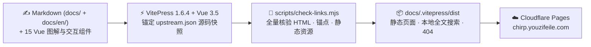

<div align="center">

<a href="https://chirp.youzifeile.com">
  
</a>

# Chirp-Doc-Page

**Chirp 官方知识库文档站 · 全站中英双语 · 交互式 E2EE 原理解析与自托管指南**

<p>
  <strong>简体中文</strong>
  &nbsp;|&nbsp;
  <a href="README.en.md"><strong>English</strong></a>
</p>

<p>
  <a href="https://chirp.youzifeile.com"></a>
  <a href="https://github.com/YouZiFeiLe/Chirp-Doc-Page/commits/main"></a>
  <a href="https://github.com/YouZiFeiLe/Chirp-Doc-Page/stargazers"></a>
  <a href="package.json"></a>
  <a href="wrangler.jsonc"></a>
  <a href="LICENSE"></a>
</p>

<p>
  <a href="https://chirp.youzifeile.com"><strong>📖 在线阅读中文站</strong></a>
  &nbsp;·&nbsp;
  <a href="https://chirp.youzifeile.com/en/"><strong>🌐 Read English Edition</strong></a>
  &nbsp;·&nbsp;
  <a href="https://github.com/YouZiFeiLe/Chirp"><strong>📦 Chirp 产品源码仓库</strong></a>
</p>

</div>

---

## ✨ 文档站核心特性

本项目是 **[Chirp](https://github.com/YouZiFeiLe/Chirp)** 的独立文档知识库，涵盖成员入门指南、Docker Compose 自托管运维、四大原生客户端专题、V5 端到端加密协议规范、安全评估报告以及本地编译验收手册：

- **🌐 全站中英双语 + 浏览器自适应**：完整提供 **31 篇简体中文 + 31 篇英文** 对等页面（共 62 篇正文章节）。首次访问会根据浏览器语言自动切换至英文站（`/en/`）或中文站，并持久化记录用户在导航栏的手动切换偏好。
- **📊 交互式图解与实用工具**：内置 14 张随语言自动切换的 Vue + SVG 原理图（网络拓扑、Passkey / QR 登录、设备信任树、群组状态机、平滑换钥、管理台级联失效、附件加密流、`.chirpkey` / `.chirplog` 结构等），以及部署路线选择器与错误码即时筛选器。
- **📱 四端架构专题与安全审计报告**：系统拆解 Apple（macOS / iOS）、Android、Windows 的模块实现与 E2EE 链路细节，并附带基于源码静态审查的安全扫描与加密链路评估报告。
- **🕒 自动更新时间与源码快照锚定**：每篇文档主标题下方自动显示最近更新时间（`UTC+8` / `UTC`）；正文中指向产品仓库 `blob/main`、`tree/main` 的源码链接会在构建期自动固定至 [upstream.json](upstream.json) 指定的精确 Commit。
- **🔗 严格的构建期断链校验**：每次执行 `npm run build` 均会通过 [check-links.mjs](scripts/check-links.mjs) 全量检查站内页面、标题锚点、图片及静态资源，缺一即拦截失败。

---

## 🛠️ 构建与发布流向



---

## 💻 本地开发与预览

在本仓库根目录使用 **Node.js 22**（见 [.nvmrc](.nvmrc)）与 `npm`：

```sh
npm ci
npm run dev
```

终端会输出本地热更新预览地址；修改 Markdown、Vue 组件或主题样式后页面会即时刷新。运行正式构建与链接检查：

```sh
npm run build
npm run preview
```

输出产物位于 `docs/.vitepress/dist/`，支持干净 URL（Clean URLs）与独立的 `404.html`。

---

## 📁 目录结构与维护约定

<details>
<summary>展开查看完整目录说明与版本同步方法</summary>

| 内容域 | 中文路径 | 英文路径 |
| :--- | :--- | :--- |
| 首页与目录 | [`docs/index.md`](docs/index.md) | [`docs/en/index.md`](docs/en/index.md) |
| 成员使用指南（5 篇） | [`docs/guide/`](docs/guide/) | [`docs/en/guide/`](docs/en/guide/) |
| 自托管部署与运维（9 篇） | [`docs/hosting/`](docs/hosting/) | [`docs/en/hosting/`](docs/en/hosting/) |
| 四端客户端与统一设计（4 篇） | [`docs/clients/`](docs/clients/) | [`docs/en/clients/`](docs/en/clients/) |
| 架构、安全评估与协议规范（9 篇） | [`docs/reference/`](docs/reference/) | [`docs/en/reference/`](docs/en/reference/) |
| 编译构建与人工验收（3 篇） | [`docs/development/`](docs/development/) | [`docs/en/development/`](docs/en/development/) |
| 站点配置与双语侧边栏 | [`docs/.vitepress/config.ts`](docs/.vitepress/config.ts) · [`navigation.ts`](docs/.vitepress/navigation.ts) | 共用配置 |
| 共享环境变量与错误码表 | [`docs/.vitepress/snippets/`](docs/.vitepress/snippets/) · [`apple-errors.inc.md`](docs/.vitepress/data/apple-errors.inc.md) | 共用数据 |
| 主题样式、原理图与交互组件 | [`docs/.vitepress/theme/`](docs/.vitepress/theme/) | 响应 `lang` 自动切换 |
| 构建校验与同步脚本 | [`scripts/check-links.mjs`](scripts/check-links.mjs) · [`scripts/sync-errors.mjs`](scripts/sync-errors.mjs) | — |

### 同步上游产品源码快照（`upstream.json`）

- [upstream.json](upstream.json) 记录当前文档核对的 `YouZiFeiLe/Chirp` 提交摘要与日期；更新上游产品版本后，运行以下命令刷新错误码表格并复核整站构建：

```sh
npm run sync:errors
npm run build
```

> [!NOTE]
> 站点使用 VitePress `1.6.4` 与 `overrides` 锁定的 Vite `6.4.6`。升级生成器的依赖版本时请同步复核构建产物。

</details>

---

## ☁️ Cloudflare Pages 部署配置

仓库根目录已附带 Pages 配置文件 [wrangler.jsonc](wrangler.jsonc)，在 Cloudflare Pages 中关联本 GitHub 仓库后使用以下配置即可：

| 配置项 | 推荐值 |
| :--- | :--- |
| **生产分支** | `main` |
| **根目录** | `/`（仓库根目录） |
| **构建命令** | `npm run build` |
| **输出目录** | `docs/.vitepress/dist` |
| **Node.js** | `22`（自动读取 `.nvmrc`） |

> [!IMPORTANT]
> 本项目面向 **Cloudflare Pages** 部署；切勿在 [wrangler.jsonc](wrangler.jsonc) 中添加 Workers 专属字段（例如 `"observability"`），否则 Pages 校验阶段会直接报错退出。

---

## 📈 仓库动态与授权许可

<div align="center">

<a href="https://star-history.com/#YouZiFeiLe/Chirp-Doc-Page&Date">
  <picture>
    <source media="(prefers-color-scheme: dark)" srcset="https://api.star-history.com/svg?repos=YouZiFeiLe/Chirp-Doc-Page&type=Date&theme=dark" />
    <source media="(prefers-color-scheme: light)" srcset="https://api.star-history.com/svg?repos=YouZiFeiLe/Chirp-Doc-Page&type=Date" />
    
  </picture>
</a>

</div>

<p align="center">
  站内沿用的 Chirp 文案、客户端图标与离线预览截图来自 <a href="https://github.com/YouZiFeiLe/Chirp">Chirp 产品仓库</a>，遵循 <a href="LICENSE"><strong>GNU Affero General Public License v3.0（AGPL-3.0-only）</strong></a>。
</p>
